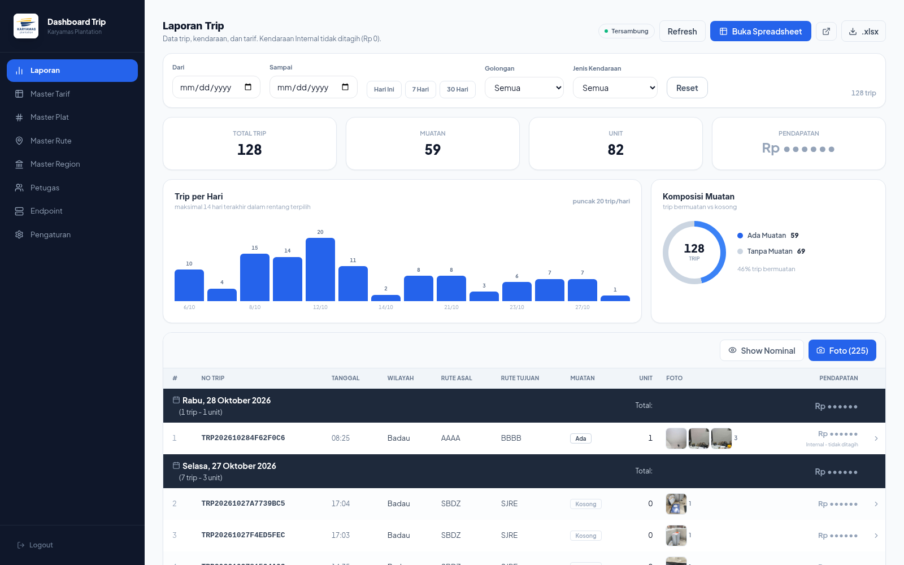
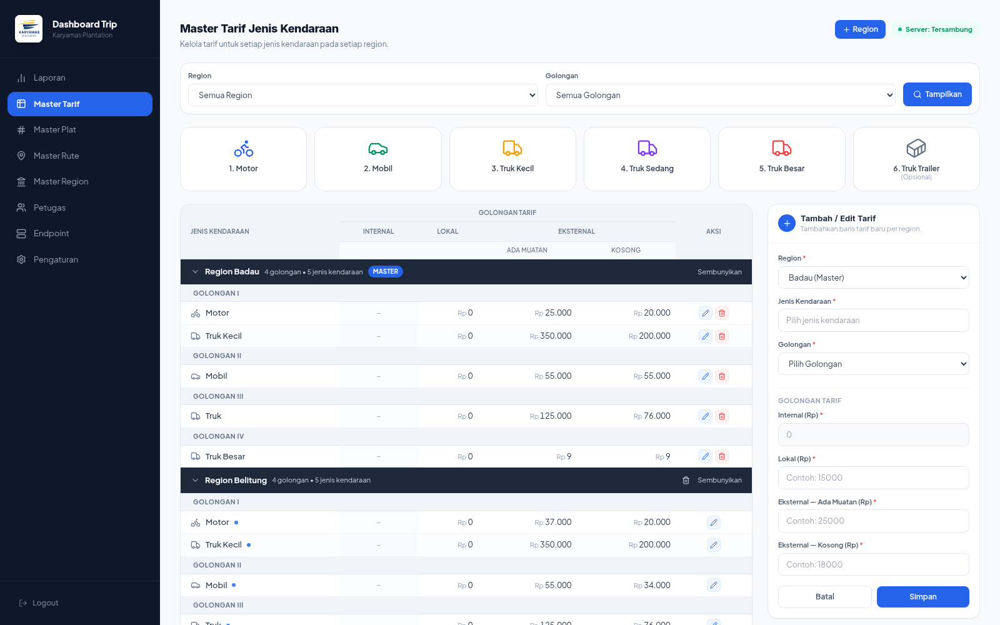
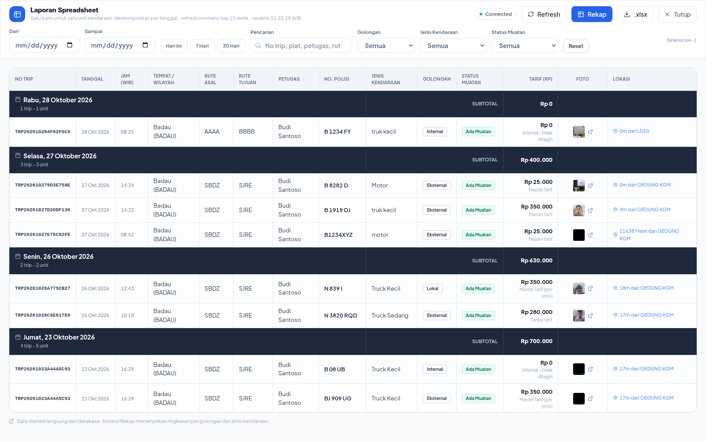
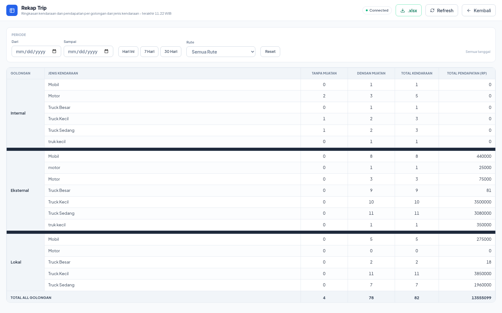
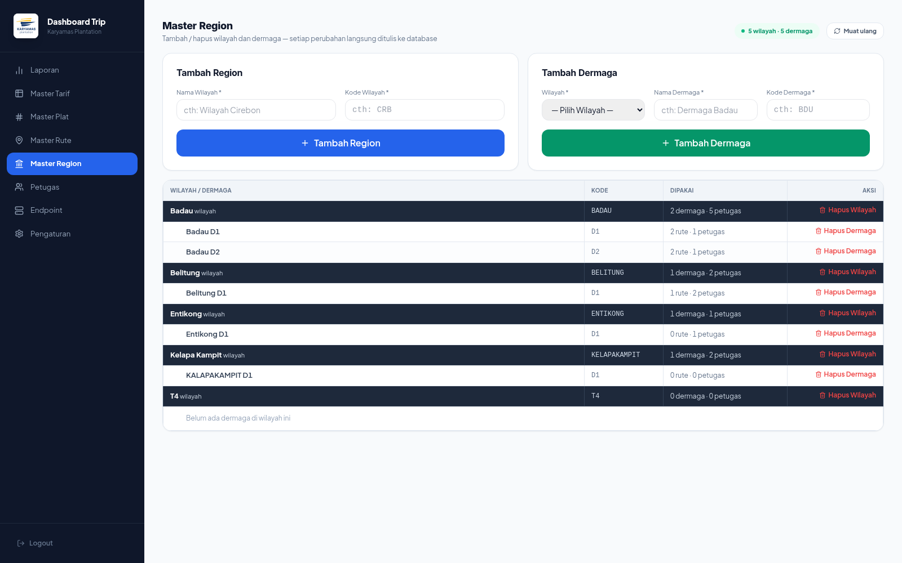
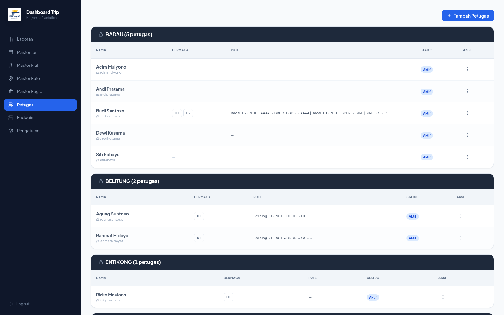
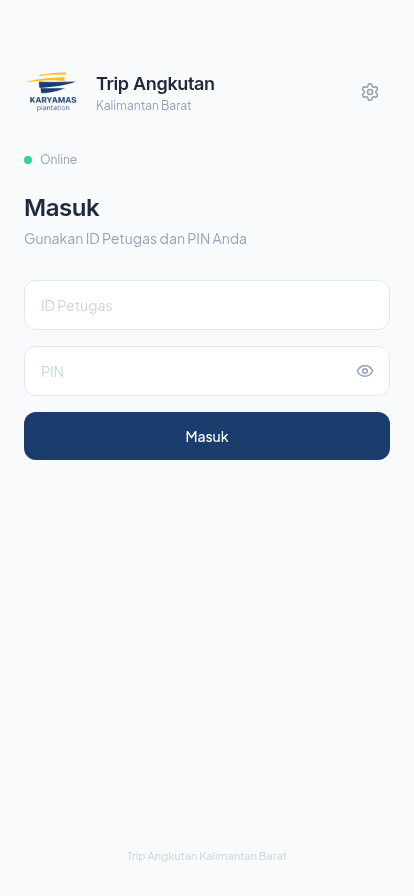

<div align="center">

# Trip Angkutan

**Offline-first field operations platform for plantation transport fleets** — a Capacitor mobile app for field officers, a real-time admin dashboard, and a self-hosted API that keeps working when the internet does not.



</div>

---

## Table of contents

- [Overview](#overview)
- [Screenshots](#screenshots)
- [What the platform does](#what-the-platform-does)
- [Architecture](#architecture)
- [Engineering highlights](#engineering-highlights)
- [Tech stack](#tech-stack)
- [Repository layout](#repository-layout)
- [Development](#development)
- [Quality](#quality)
- [Further documentation](#further-documentation)

---

## Overview

Trip Angkutan is an end-to-end system for a transport operation spread across
remote plantation areas, where connectivity is unreliable and every trip has to
be documented with photographic evidence of the vehicle.

The product ships as two front-ends from a single codebase:

- a **Capacitor/Android app** used by field officers in the field — login by
  username/password or 6-digit PIN, trip creation, camera capture, licence-plate
  OCR, geofence validation, and a local queue that survives dead zones;
- a **React admin dashboard** for supervisors — master data (tariffs, routes,
  regions, plates, officers), live trip reporting with spreadsheet-style views,
  and Excel export.

The backend is a **Deno REST API** that talks to **PostgreSQL through
PostgREST**, deployed as an **intranet server inside the office LAN**
(Docker Compose, port `3000`) so daily operations never depend on an internet
uplink. The mobile app points at it by default and can be re-pointed at any
compatible endpoint at runtime from *Profile → Server*.

---

## Screenshots

| Trip reports & live dashboard | Master Tarif (per-region tariff matrix) |
|---|---|
|  |  |

| Spreadsheet-style trip sheet | Recap per vehicle class |
|---|---|
|  |  |

| Master Region & dermaga | Officers per region |
|---|---|
|  |  |

| Mobile app (officer login) |
|---|
|  |

> Screenshots are regenerated from the running application with
> `node scripts/capture-screenshots.mjs` (headless Chromium over the DevTools
> Protocol — no extra dependency beyond the `ws` module already in the repo).

---

## What the platform does

### Field officer app (Capacitor + Android)

- **Identity & access** — username/password or 6-digit PIN, JWT sessions with
  silent renewal, per-device credential sync, and officer switching for shared
  handsets.
- **Trip capture** — a guided flow: choose *empty* or *loaded*, pick the route,
  register the vehicle (plate, type, class), add condition notes, and attach a
  mandatory camera photo. A trip cannot be submitted without photographic
  evidence.
- **Plate OCR** — on-device OCR (Tesseract.js) reads the plate from the camera
  frame and matches it against the plate registry to classify the vehicle as
  *internal*, *local*, or *external* — which decides how it is billed.
- **Geofencing** — GPS watch against configurable per-dermaga geofences, so a
  trip can only be filed inside the authorised area.
- **Offline-first** — every master-data set and every pending trip is stored
  locally (IndexedDB + Capacitor SQLite). The sync queue retries with
  exponential backoff and reconciles on reconnect; the server stays the source
  of truth.

### Admin dashboard (React)

- **Trip reports** — filterable by date range, vehicle class and vehicle type;
  expandable trip rows with per-vehicle breakdown, load composition charts, and
  a "show nominal" privacy toggle for revenue figures.
- **Spreadsheet & recap views** — the same data rendered as a ledger-style
  sheet and as a per-class recap, both exportable to `.xlsx`.
- **Master data** — per-region tariff matrices (with a master region that
  everything else inherits from), routes grouped by region → dermaga, regions
  and dermaga, vehicle plate registry, and officer accounts with per-region and
  per-dermaga access.
- **Operations** — endpoint configuration, server health and hardware telemetry
  (CPU, RAM, disk, load, request rate), plus in-app theme and density
  preferences.

### Backend & infrastructure

- **One API, two deployments** — the same Deno handler serves the public
  endpoint and the office intranet server; the mobile app switches between them
  at runtime from *Profile → Server*.
- **Self-hosted data plane** — PostgreSQL 16 + PostgREST + the API service,
  orchestrated by Docker Compose with health checks, idempotent migrations and
  persistent volumes for uploaded media.
- **Observability** — request metrics (rate, success ratio, latency, per-minute
  buckets, hot paths) and hardware telemetry collected by the API itself and
  surfaced in the admin dashboard.

---

## Architecture

```
┌───────────────────────────┐        ┌───────────────────────────┐
│  Mobile app (Capacitor)   │        │  Admin dashboard (React)  │
│  React + TypeScript       │        │  static SPA, port 8000    │
│  camera · OCR · geofence  │        │  tariffs · reports · xlsx │
│  offline queue (IndexedDB)│        └─────────────┬─────────────┘
└─────────────┬─────────────┘                      │
              │   HTTP/HTTPS (LAN :3000, endpoint aktif) │
              └───────────────┬──────────────────────┘
                              ▼
                 ┌──────────────────────────┐
                 │   Deno API (server/api)  │
                 │  auth · trips · tariffs  │
                 │  plates · reports · OTA  │
                 │  metrics · rate limiting │
                 └────────────┬─────────────┘
                              │  PostgREST
                 ┌────────────▼─────────────┐
                 │  PostgreSQL 16           │
                 │  schema + migrations     │
                 └──────────────────────────┘
```

| Layer | Technology | Notes |
|---|---|---|
| Mobile shell | Capacitor 8 (Android) | camera, geolocation, filesystem, network state |
| Frontend | React 19 + TypeScript + Tailwind CSS | one codebase, two shells (`/` mobile, `/admin` desktop) |
| Build | Angular application builder (esbuild) | output normalised into `www/`, verified before deploy |
| API | Deno + `Deno.serve` | REST, JWT auth, bcrypt, rate limiting, CORS hardening |
| Data | PostgreSQL 16 + PostgREST 12 | migrations in `server/db/migrations/` |
| Storage | local object store on the API host (trip photos, APK, OTA bundles) | served by the API, persisted in a Docker volume |
| Packaging | Docker Compose | `web`, `api-intranet`, `db`, `rest` |

---

## Engineering highlights

- **The API runs where the work happens.** The Deno service is deployed next to
  the office database, not behind a public cloud, and the mobile app switches
  to it at runtime. A shared `JWT_SECRET` keeps tokens valid across endpoints,
  so moving between them never logs an officer out.
- **Offline is the default, not a fallback.** Master data is prefetched and
  cached, trips are queued locally with retry/backoff, and reconciliation
  happens on reconnect. The app is fully usable with the radio off.
- **Tariff resolution without row copying.** A region's price is resolved in a
  defined order — internal (Rp 0) → per-region override → master tariff → flat
  regional rate → free. A new region inherits the master tariff automatically
  instead of duplicating dozens of rows.
- **Evidence-first billing.** A trip is locked until a photo exists, and the
  captured frame is OCR'd to classify the vehicle, which drives the tariff
  applied to that trip.
- **Deploy safety net.** The build script re-verifies every chunk reference in
  the generated bundle and fails hard on a broken artefact, so a bad bundle can
  never reach the field.
- **Observable from the dashboard.** The API measures itself and reports CPU,
  memory, disk and request rate to the admin UI — no external monitoring stack
  required.

---

## Tech stack

| Area | Stack |
|---|---|
| Frontend | React 19, TypeScript 6, Tailwind CSS 3, lucide-react, hand-rolled SVG charts |
| Mobile | Capacitor 8 (Android), Capacitor SQLite, Tesseract.js (OCR), service worker + OTA updater |
| Backend | Deno, standard `Request`/`Response` handlers, JWT (24 h), bcrypt, custom rate limiter |
| Database | PostgreSQL 16, PostgREST 12, SQL migrations |
| Infrastructure | Docker Compose, nginx, health checks, persistent volumes |
| Quality | Vitest (33 test files), ESLint, `tsc --noEmit`, Deno test runner for the API |

---

## Repository layout

```
src/                     React app: mobile shell + admin dashboard
  pages/mobile/          officer screens (trip flow, camera, geofence, history)
  pages/admin/           admin shell, tabs, report sheet & recap views
  services/              api, auth, sync, offline db, OCR, OTA, geofence, xlsx
  theme/                 design tokens shared by both shells
server/
  api/                   Deno API: handlers, metrics, system telemetry
  db/                    schema.sql + timestamped SQL migrations
scripts/                 build helpers, OTA publisher, screenshot capture
docs/                    deployment notes, incident reports, screenshots
android/                 Capacitor Android project
admin-www/               built admin dashboard served on port 8000
```

---

## Development

```bash
npm install

npm run start          # dev server for the app (port 5173)
npm run build          # production build + bundle verification
npm run test:unit      # unit tests
npm run lint           # ESLint
npm run docs:screenshots # regenerate README screenshots
npx tsc --noEmit -p tsconfig.app.json
```

Run the full stack (admin dashboard, intranet API, database) with:

```bash
docker compose build api-intranet web
docker compose up -d
```

The admin dashboard is then served from `admin-www/` on port `8000`, the
intranet API on `3000`, and the mobile dev server on `5173`.

> On the office network the same services are started and health-checked by
> `restart-all-ubuntu.sh`; see `docs/DEPLOY-UBUNTU-LOCAL.md` for the rollout
> procedure and the LAN topology.

---

## Quality

| Check | Command |
|---|---|
| Unit tests (frontend + API) | `npm run test:unit` |
| API tests (Deno) | `deno test --allow-env --allow-net --allow-read --allow-write server/api/` |
| Types | `npx tsc --noEmit -p tsconfig.app.json` |
| Lint | `npm run lint` |
| Bundle integrity | `npm run build` (fails hard on broken chunk references) |

---

## Further documentation

| Document | Contents |
|---|---|
| [`Architecture.md`](Architecture.md) | components, data flow, endpoint map |
| [`PRD.md`](PRD.md) | product requirements and feature scope |
| [`Structure.md`](Structure.md) | directory map and file responsibilities |
| [`OFFLINE-FIRST-ARCHITECTURE.md`](OFFLINE-FIRST-ARCHITECTURE.md) | offline strategy, queue, reconciliation |
| [`ALUR_APLIKASI.md`](ALUR_APLIKASI.md) | screen-by-screen flow |
| [`docs/DEPLOY-UBUNTU-LOCAL.md`](docs/DEPLOY-UBUNTU-LOCAL.md) | office-server deployment |

---

<div align="center">
<sub>Built for field operations in low-connectivity environments.</sub>
</div>
